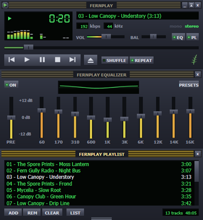
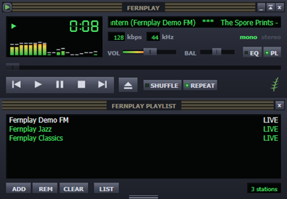
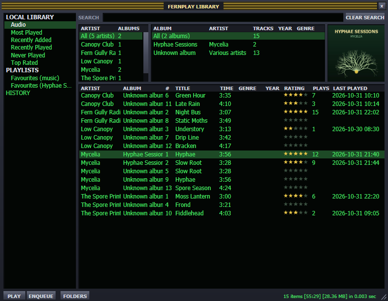
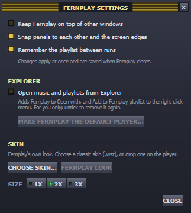

#  Fernplay

A small music player for Windows in the style of the late-90s desktop players: a player panel with a green LCD, a 10-band equalizer and a playlist, as three panels that snap together and come apart. It also plays internet radio and has an optional media library. No account, and nothing goes online except the radio stations you play and the update check when you press it.

Windows 10 (1607 or later) and 11, x64.

## Install

Download from [Releases](https://github.com/codekunde/Fernplay/releases). Most people want the installer.

### Installer (recommended)

**`Fernplay-<version>-win-x64.msi`** (about 56 MB, .NET included, nothing else to install)

1. Double-click the MSI. It installs in a few seconds, for your Windows account only, with no admin prompt.
2. Start Fernplay from the Start menu (type "Fernplay").

The installer puts Fernplay in `%LOCALAPPDATA%\Programs\Fernplay` and sets it up in Explorer: music files and playlists list it under **Open with**, and folders get **Play in Fernplay** and **Add to Fernplay playlist**.

**Make Fernplay your music player:** right-click a music file (an MP3, say), choose **Open with > Choose another app**, pick **Fernplay** and **Always**. Repeat for other file types you use (FLAC, M4A, playlists). Windows lets only you make this choice; no app can set itself as the default.

**Update:** About Fernplay → CHECK FOR UPDATE → UPDATE (from 0.9.0 on) downloads the newer MSI, checks it against the checksum GitHub lists for it, closes Fernplay, installs the update and starts Fernplay again. Or download the newer MSI yourself and double-click it. Either way it replaces the old version and keeps your settings, library and skins. If you unticked "Open music and playlists from Explorer" in Settings, it stays off.

**Uninstall:** Windows Settings > Apps > Fernplay > Uninstall. This also removes the Explorer set-up. Your settings stay in `%APPDATA%\CodeKunde\Fernplay`; delete that folder too for a clean removal.

### Portable (no install)

- **`Fernplay-<version>-win-x64-standalone.zip`** (about 57 MB, .NET included)
- **`Fernplay-<version>-win-x64.zip`** (under 1 MB): needs the [.NET 10 Desktop Runtime](https://dotnet.microsoft.com/download/dotnet/10.0) (x64). If it is missing, Fernplay says so at start with a link to it.

Unzip anywhere, a USB stick included, and run `Fernplay.exe`. A portable Fernplay keeps its settings, library and skins in a `Data` folder next to `Fernplay.exe`, because of the `portable.txt` file beside it. On its first start it copies them from an installed Fernplay, if there is one. Delete `portable.txt` to use `%APPDATA%\CodeKunde\Fernplay` instead.

A portable copy does not touch Explorer unless you tick "Open music and playlists from Explorer" in its Settings. To update, unzip the newer version over the old folder (the `Data` folder stays). To remove it, untick that option first if you ticked it, then delete the folder.

### "Windows protected your PC"

Fernplay is not code-signed yet, so Windows may show this the first time you run the MSI or the exe: choose **More info**, then **Run anyway**.



## The three panels

- **Player:** 7-segment clock (click it for time left), spectrum analyser, scrolling title, kbps, kHz, mono/stereo, volume and balance (the mouse wheel works on both; balance snaps back to the centre within 15 %, and a double-click centres it), position bar, previous / play / pause / stop / next, open (right-click it for a folder), SHUFFLE, REPEAT (a click repeats the whole list or stops repeating; a right-click, the menu key or Shift+F10 repeats this track; the tooltip says which is on), XFADE (crossfade: when a song ends by itself it fades into the next, 1 to 12 seconds, set in Settings; skipping by hand, stations and repeat track never fade; with classic skins it is **Crossfade** in the app menu), and EQ / PL switches that show or hide the other panels.
- **Equalizer:** ON switch, curve preview, preamp and 10 bands (60 Hz to 16 kHz, ±12 dB; bars turn from green to orange as they boost; a double-click sets a slider back to 0 dB), PRESETS (Flat, Rock, Pop, Classical, Dance, Bass boost, Treble boost, Vocal, and your own: **Save current as…** keeps the current settings under a name, **Delete preset** removes one of yours). Changes apply live.
- **Playlist:** tracks as "03 - Artist - Title" (or "Artist - Title" without a track number) with their length, the playing one highlighted; double-click or Enter plays, Delete or REM removes, ADD adds files or a folder, CLEAR empties it, LIST opens or saves a playlist file; total length in the corner. Drag tracks to reorder them (several at once), or use Alt+Up / Alt+Down. Drag the panel's bottom edge to show more or fewer rows; near the bottom of the equalizer or another panel it snaps level with it. The bottom-right corner also changes the width (never narrower than the player).

Drag a panel by its title bar: it snaps to the other panels and to the screen edges. Dragging the player panel moves every panel docked to it; dragging the EQ or playlist alone pulls it loose. The panel that has the keyboard shows a lit title bar; the others are dimmed.

**Windowshade.** The shade button on the player's title bar, a double-click on the title bar or Ctrl+W rolls the player up to a strip as tall as its title bar: the scrolling song title, the time (click it to switch between played and left), a small transport and a position bar. The same again, or a double-click on the strip, rolls it down; panels docked below move with it, and Fernplay remembers it for the next start.

## Opening music

- The eject button (Ctrl+O), or ADD in the playlist.
- Drop files or folders on the player (replaces the list and plays) or on the playlist (adds to the end).
- From the command line: `Fernplay.exe song.mp3 Album\` replaces the list; `Fernplay.exe /add song.mp3` adds to the end.
- From Explorer: set up by the installer; a portable copy once switched on in Settings (see below).

Only one Fernplay runs at a time: anything opened while it runs goes to the running player. Several files opened together become one list in Explorer's name order.

Plays MP3, FLAC, WAV, WMA and AAC (M4A) with Windows' own decoders. OGG and Opus are not supported yet: Windows has no decoder for them. A file that cannot be played is skipped and the reason scrolls through the title display.

On a Windows "N" edition, install Microsoft's Media Feature Pack first: without it Windows has no audio decoders.

### Playlist files

LIST opens and saves `.m3u` and `.m3u8`; `.pls` opens too. Playlists also open from the open dialog, by drag and drop and from the command line. Entries inside the playlist's folder are saved relative to it. Missing or unplayable entries are left out, and the title display says how many.

## Internet radio



Stream addresses (`http://` or `https://`) in a `.m3u`, `.m3u8` or `.pls` file, or on the command line, play as live stations, marked LIVE in the playlist:

- The station's name comes from the playlist; if it has none, Fernplay uses the name the station sends and remembers it.
- MP3 stations that send the song in the stream show "Artist - Title (Station)" in the title display, the window title and the Windows media overlay. The title changes when the song changes on the speakers, not when the data arrives. Not every station sends song titles.
- The seek bar is off and the clock counts up. Stop disconnects, Play connects again.
- A station that drops or goes quiet for 15 seconds reconnects (up to three times a minute). A station that can't be reached stays selected and the title display says why: no answer, connection refused or blocked, secure (https) connection failed, address not found, a proxy, or the station's own answer (for example 404 when its address has changed).

If a station plays in the browser but not in Fernplay on the same PC, a firewall or security program is usually blocking Fernplay.exe (a browser is already trusted; a new program often is not), or a program that inspects https traffic is breaking the secure connection. Allow Fernplay.exe there.

## Media library



Open it from the app menu (Media library…) or with Alt+L. It is optional: nothing is scanned or saved until you add a folder, and the three panels work as before without it.

- **Folders:** FOLDERS adds a music folder (scanned in the background), rescans, stops a scan, or removes a folder from the library (the files stay on disk). Fernplay looks for new and changed files at every start; files it already knows are not read again.
- **Views:** Audio (everything), Most Played, Recently Added and Recently Played (the last two weeks), Never Played, Top Rated (three stars or more), the playlist files found in your folders, and History (every play, newest first). A play counts after half the track or four minutes.
- **Finding music:** type in SEARCH (every word must match; accents do not matter), pick an artist and an album, click a column header to sort (again to reverse).
- **Playing:** PLAY replaces the playlist with the selected tracks (or all shown), ENQUEUE adds them to the end; double-click or Enter plays, Shift+Enter adds. Drag tracks to the playlist or the player.
- **Covers:** the picture inside the file, or `folder.jpg`, `cover.jpg`, `front.jpg` or an `AlbumArt` picture in the album's folder.
- **Ratings:** click the stars (the same star again clears it), press 0 to 5, or right-click. Ratings stay in Fernplay's library; music files are never changed.
- **Missing tags** are filled from folder and file names: `Artist\Album\01 - Title.mp3` or `01 - Artist - Title.mp3`.

The library docks beside the player, as tall as the panels together, and keeps that height when the skin or its size changes, until you drag its bottom-right corner. It is kept in `library.json` next to the settings.

## File info (editing tags)

Alt+3, as on the classic player, opens a track's file info: title, artist, album, album artist, track number, year, genre, composer and comment. In the playlist and the library it is the selected track (also on the right-click menu, and on a classic skin's MISC button); on the player it is the track that is playing. SAVE writes only the fields you changed into the file; an emptied field is removed. Several artists go in one field with a semicolon (`A; B`).

Tags are written by Windows itself, the same way Explorer's Details pane edits them: MP3, M4A and WMA. Other formats (FLAC) work where Windows can write their tags; where it cannot (WAV), Fernplay says so and changes nothing. A file that is read-only or open in another program says so and is left as it was. Editing the playing track is fine: Fernplay lets go of the file for a moment and plays on from the same place. Ratings are not written to files; they stay in the library.

## Keys

| Key | Does |
|---|---|
| Z X C V B | Previous, play, pause, stop, next (in every panel) |
| Space | Play / pause (in every panel, also right after clicking a button) |
| Enter | Press the focused button; in the playlist, play the selected track |
| Left / Right | Seek 5 s back or forward (player panel) |
| Up / Down | Volume (player panel) |
| Ctrl+O | Open files |
| Delete | Remove the selected tracks (playlist) |
| Alt+Up / Alt+Down | Move the selected tracks (playlist) |
| Alt+3 | File info: edit the tags of the selected track (playlist, library) or the playing one (player) |
| Alt+L | Show or hide the media library |
| Ctrl+W | Windowshade: roll the player up to a thin strip, or down again |
| Ctrl+F | Search the library; Esc clears the search, Esc again hands the keys back to the player |
| Shift+Enter | Add the selected tracks to the playlist (library) |
| 0 to 5 | Rate the selected tracks (library) |
| Delete | Remove the selected plays (library, History) |
| Esc | Close Settings or About |

**Media keys and the Windows media overlay.** Fernplay registers with Windows' media session, so the keyboard's play/pause, stop, next and previous keys work while other apps have focus, and Windows' media overlay (next to the volume flyout) shows the track with its buttons.

If the media keys do nothing while Fernplay plays, another program has taken them first. Winamp, for example, catches them with its global hotkeys while it runs: close it, or switch off its multimedia keys under Preferences, Global Hotkeys.

A media-button pause in the first 3 seconds of a song is ignored: some Windows 11 PCs send one by themselves when a new song starts, which left the next song paused.

## Settings



Open them from the Fernplay icon at the top left of the player (Settings…, About Fernplay, Exit). About shows the version; CHECK FOR UPDATE asks GitHub for the newest release. When there is a newer one, the installed Fernplay offers UPDATE (download, check, install, restart); a portable or zip copy offers DOWNLOAD, which opens the release page.

- **Keep Fernplay on top** of other windows.
- **Snap panels** to each other and to the screen edges.
- **Remember the playlist** between runs.
- **Open music and playlists from Explorer** (on after installing with the MSI, off in a portable copy; for the current user only, no admin rights): adds Fernplay to Open with and Default apps, gives the files it plays its file icon, and adds "Add to Fernplay playlist" (files and folders) and "Play in Fernplay" (folders) to the right-click menu. Untick it to remove everything again. **Make Fernplay the default player…** then opens Windows' own page for the choice.
- **Skin:** CHOOSE SKIN… picks a classic skin file, FERNPLAY LOOK goes back to Fernplay's own drawing, SIZE sets 1x, 1.5x or 1.75x for skins (see below).

Fernplay remembers the panel positions, which panels are shown, volume, balance, EQ and your own EQ presets, shuffle, repeat, crossfade, the playlist's height and width, the skin and its size, the playlist and station names in `%APPDATA%\CodeKunde\Fernplay\settings.json` (a portable copy: `Data\settings.json` next to `Fernplay.exe`). The `FERNPLAY_DATA` environment variable points it at another folder.

Next to it, `diagnostics.log` (at most about 512 KB, never sent anywhere) notes play and pause and what asked for them, Windows media buttons (and the ones ignored at a song's start), track ends, stations that could not be opened and why, lock and unlock, and display changes with the panel positions. It helps trace a fault that happens only now and then.

## Classic skins

Fernplay can wear classic player skins: the `.wsz` files made for the 2.x generation of skinnable players (many are still shared online). Choose one in Settings (CHOOSE SKIN…) or drop a `.wsz` on the player. Fernplay copies it into a `Skins` folder next to its settings and remembers it. Fernplay ships no skins; its own look stays the default.

With a skin, all three panels and the library are drawn from the skin's pictures, at 1x (pixel-sharp), 1.5x or 1.75x (about the size of Fernplay's own look):

- **Player:** everything as above, plus the skin's balance slider; rolled up (windowshade), it is the skin's own strip with a mini spectrum, time, transport and position bar.
- **Equalizer:** preamp and bands whose colour follows the gain, ON, PRESETS and the curve in the skin's colours.
- **Playlist:** the skin's frame, colours and font, scroll knob, selected/total running time, a small transport and clock, and the classic button menus: ADD (folder, files), REM (all, crop, selected, missing files), SEL (invert, none, all), LIST (new, save, open). Drag the bottom-right corner to make it taller (29 px steps) or wider (25 px steps).
- **Library:** the skin's frame and title letters (GEN.BMP) and its library colours for lists, selection, headers, buttons and scroll bars (GENEX.BMP). The text keeps Fernplay's size. A skin without these pictures leaves the library in Fernplay's look.

Not there yet: EQ AUTO, sort and options in the MISC menu (its file info works), adding a stream address from ADD, windowshade for the equalizer and playlist, window outlines and cursors from the skin. These are drawn but do nothing. A file that is not a usable skin is refused with the reason in the title display, and the current look stays.

## Build

Needs the .NET 10 SDK.

```
dotnet build Fernplay.slnx
dotnet test Fernplay.slnx
dotnet publish src/Fernplay.App -c Release -o publish   # publish\Fernplay.exe
```

The published exe (about 2 MB) is framework-dependent: it needs the .NET 10 Desktop Runtime on the PC. The standalone exe carries .NET inside (about 65 MB):

```
dotnet publish src/Fernplay.App -c Release -o publish-standalone -p:SelfContained=true -p:IncludeNativeLibrariesForSelfExtract=true -p:EnableCompressionInSingleFile=true
```

`tools/Build-Release.ps1` builds the release files (MSI and both portable zips) into `dist/<version>`. The MSI is built with the [WiX Toolset](https://wixtoolset.org) 5.0.2 SDK (MS-RL), which NuGet fetches (`-SkipMsi` builds only the zips). It stays on 5.0.2: later WiX versions add maintenance-fee terms. App and file icons are drawn by `tools/Make-FernplayIcons.ps1`.

## How it is built

Three parts in a chain, each replaceable on its own: **decoder → EQ → output** (plus a spectrum tap and the volume).

| Folder | What |
|---|---|
| `src/Fernplay.Core` | No UI. `PlayerEngine` (load in the background, play, pause, stop, seek, volume, track end, stream titles), `Audio/` (`MediaFoundationDecoder`; `IcyMp3Decoder`, `IcyStream` and `IcyMetadata` for radio song titles; `Equalizer` and `EqualizerStage` (RBJ peaking biquads), `SpectrumTap` (FFT), `GainStage`, `WasapiAudioOutput`), `Playlist` (shuffle, repeat, remove, move, opening playlists), `M3u` and `Pls`, `PanelLayout` (snapping and docking maths), `PlaylistHeight`, `Track` and `TagReader` (Windows property system), `ShellRegistration` (Explorer entries under HKCU), `DataFolder` (where settings live: installed or portable), `OpenRequest`, `PlaybackErrors` (including why a station could not be reached), `UpdateCheck` (GitHub's latest release), `TimeFormat`; `Skins/` (`ClassicSkin`: `.wsz` reader with size limits, own `BmpDecoder`, `SkinTextFiles` for PLEDIT/VISCOLOR/REGION, `SpriteMap`, `SkinFont`, `ClassicLayout` and `ClassicPlaylist` positions, `SkinLibrary`, `GenSkin` for the library's frame and colours); `Library/` (`LibraryIndex` (the JSON index, play counts, ratings, history), `LibraryScanner` (background scan, only changed files re-read), `LibraryQuery` (views, search, panes, status line), `PathTags`, `CoverFiles`, `PlayRules`) |
| `src/Fernplay.App` | `Fernplay.exe`, WPF: `Skin.xaml` (Fernplay's own look: palette, buttons, sliders, menus, scroll bar, glyphs; all drawn, no bitmaps), `SkinControls` (7-segment clock, spectrum, marquee, EQ curve), `SkinWindow` (dragging, snapping, docked panels following a size change), `MainWindow`, `EqWindow`, `PlaylistWindow` (each with a `.Classic.cs` part that builds the skinned view over the same controls), `Classic/` (sprite buttons, sliders, text, clock, spectrum, EQ graph, `GenFrame` for the library), `LibraryWindow` and `LibraryService` (index file, scans, play counting), `CoverCache` (Windows thumbnails and folder pictures), `StarRating`, `SettingsWindow`, `AboutWindow`, `PlayerController`, `MediaSession` (Windows media session through COM, no WinRT package), `SingleInstance`, `ShellNotify`, `FocusRing`, `UserSettings`, `DiagnosticLog` |
| `installer` | WiX 5.0.2 MSI (`Package.wxs`): per-user, Start menu entry, in-place upgrades, `Fernplay.exe /register` on install and update, `/unregister` on uninstall |
| `tests/Fernplay.Tests` | xUnit tests; they write their own audio and use a fake output, so they need no sound card or internet (the station error tests use small servers on localhost) |

Audio: [NAudio](https://github.com/naudio/NAudio) 3.2 (MIT), Media Foundation for decoding, Windows' MP3 codec (ACM) for radio stations with song titles, WASAPI shared mode for output (follows the default device when it changes). See [THIRD-PARTY-NOTICES.md](THIRD-PARTY-NOTICES.md).

Fernplay's own look follows the classic skinned players in spirit; every part of it is Fernplay's own drawing. Classic skins are files the user supplies; the sprite positions follow the public classic skin layout as documented in Webamp's sprite table (MIT, see THIRD-PARTY-NOTICES). The screenshots show made-up demo tracks and a local test station.

MIT licence. Copyright (c) 2026 CodeKunde.
